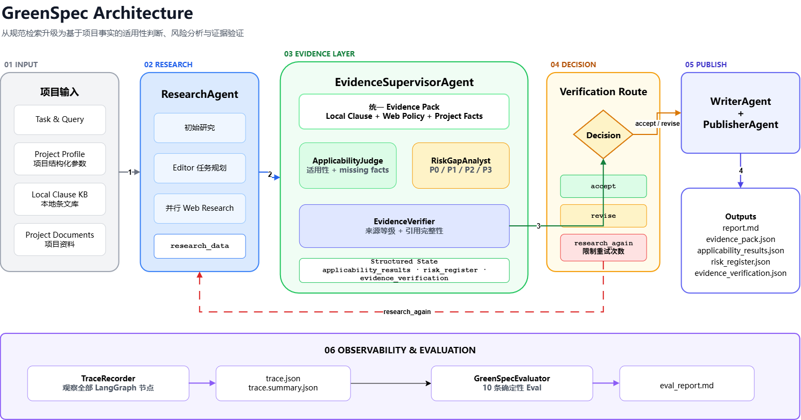

# GreenSpec

基于 GPT Researcher 与 LangGraph 二次开发的建筑规范适用性、证据验证与风险分析系统。

GreenSpec 面向绿色建筑方案及初步设计阶段的咨询预审场景，将“检索规范和政策资料”扩展为“结合项目参数判断条文适用性、识别资料缺口并输出结构化风险”。

GreenSpec 不执行自动审图，不替代绿色建筑专业人员，也不直接给出最终星级认证结论。

## 核心能力 Core Capabilities

- 从本地条文库、Web research 和项目资料构建统一证据包
- 根据区域、建筑类型、设计阶段和项目事实判断条文适用性
- 输出 `applicable`、`not_applicable`、`needs_manual_review`
- 根据项目缺口生成 P0/P1/P2/P3 风险
- 验证 claim 的证据等级、引用字段和来源完整性
- 根据验证结果执行 `accept`、`revise`、`research_again`
- 保存 Agent 执行 Trace，并运行 10 条确定性评估
- 导出可供 Writer、Publisher 或其他系统消费的 JSON

## 与上游项目（GPT Researcher）的区别

GreenSpec 不是从零开发的通用研究 Agent，而是基于
[GPT Researcher](https://github.com/assafelovic/gpt-researcher) 进行的领域化二次开发。

GPT Researcher 提供了通用 Web research、研究规划、并行研究和报告生成能力。GreenSpec 在其基础上增加了建筑规范领域的结构化证据层。

| 能力                     | 来源                  |
| ---------------------- | ------------------- |
| Web research、研究规划、报告写作 | GPT Researcher 上游能力 |
| LangGraph 主流程编排        | 基于上游架构扩展            |
| 本地规范条文检索               | GreenSpec 扩展        |
| Applicability Judge    | GreenSpec 新增        |
| Risk & Gap Analyst     | GreenSpec 新增        |
| Evidence Verifier      | GreenSpec 新增        |
| JSON Schema 与输出协议      | GreenSpec 新增        |
| Trace Recorder         | GreenSpec 新增        |
| 10 条确定性 Eval           | GreenSpec 新增        |
| 北京办公楼双场景样例             | GreenSpec 新增        |


## 架构图 Architecture




## Agent职责 Agent Responsibilities

| 模块                      | 输入                                    | 输出                    | 边界                           |
| ----------------------- | ------------------------------------- | --------------------- | ---------------------------- |
| ResearchAgent           | query、任务配置                            | Web research          | 不负责最终合规判断                    |
| EvidenceSupervisorAgent | research state、profile、条文库、项目文档       | evidence pack         | 负责编排证据层，不直接写最终报告             |
| ApplicabilityJudge      | project profile、local clause evidence | applicability results | 只判断适用性，不生成风险                 |
| RiskGapAnalyst          | project profile、applicability results、evidence pack（含 gaps）                | P0-P3 risk register   | 不替代专业人员确定最终风险                |
| EvidenceVerifier        | evidence pack（含 claims 和 evidence items）                 | verification decision | 检查来源和引用完整性，不做完整语义事实核验        |
| WriterAgent             | research data、verification feedback   | 报告章节                  | 不得把 unsupported claim 写成确定事实 |
| PublisherAgent          | research state                        | Markdown 与 JSON       | 只负责导出，不修改判断结果                |
| TraceRecorder       | Agent 输入输出                            | trace.json            | 对敏感字段脱敏，但完整 trace 仍可能较大      |
| GreenSpecEvaluator  | run output                            | eval_report.md        | 当前为 10 条项目级确定性检查，不是行业基准测试    |

## 输出协议 Output Protocols

| 文件                           | 用途                     | 协议                                                                              |
| ---------------------------- | ---------------------- | ------------------------------------------------------------------------------- |
| `evidence_pack.json`         | 汇总证据、claims、gaps 和分析结果 | [output_protocol.md](./greenspec/contracts/output_protocol.md)                  |
| `applicability_results.json` | 每条条文一条适用性结果            | [applicability schema](./greenspec/contracts/applicability_results.schema.json) |
| `risk_register.json`         | 每条风险一条记录               | [risk schema](./greenspec/contracts/risk_register.schema.json)                  |
| `evidence_verification.json` | claim 验证与 run 决策       | [verification schema](./greenspec/contracts/evidence_verification.schema.json)  |
| `trace.json`                 | Agent 执行过程             | 当前未建立独立 Schema                                                                  |
| `eval_report.md`             | 10 条确定性评估结果            | Markdown 报告                                                                     |

### Applicability Status

```text
applicable
not_applicable
needs_manual_review

```
### Risk Levels

```text
P0 - 阻断核心判断的高优先级风险
P1 - 专项计算、模拟或重要资料风险
P2 - 需要专业人员人工复核
P3 - 来源、引用或文档质量问题

```
### Verification Decisions

```text
accept
revise
research_again
```

## 项目结构 Repository Structure

```
greenspec/
├── contracts/          # JSON Schema 和输出协议
├── evals/              # 10 条评估用例与 fixtures
├── knowledge_base/     # 本地条文库
├── profiles/           # 项目参数
├── project_docs/       # 项目资料摘要
└── sample_tasks/       # 可复现任务配置

multi_agents/
├── agents/
│   ├── applicability_judge.py
│   ├── evidence_supervisor.py
│   ├── evidence_verifier.py
│   ├── risk_gap_analyst.py
│   └── publisher.py
├── evaluation/
└── observability/

samples/
├── beijing_office_incomplete/
└── beijing_office_improved/
```

## Quick Start

### Requirements

- Python 3.11+
- DeepSeek API Key：聊天模型
- Tavily API Key：Web 检索
- OpenAI API Key：`text-embedding-3-small` embedding

### Installation

```powershell
python -m venv .venv
.\.venv\Scripts\Activate.ps1
python -m pip install --upgrade pip
python -m pip install -r requirements.txt -r requirements-dev.txt
```

### Environment

复制环境变量模板：

```powershell
if (-not (Test-Path .env)) {
    Copy-Item .env.example .env
}
```

打开 `.env`，填写自己的 API Key。默认配置使用 DeepSeek 作为聊天模型、Tavily 作为 Web 检索服务、OpenAI 作为 embedding 服务：

```dotenv
DEEPSEEK_API_KEY=your-deepseek-api-key
TAVILY_API_KEY=your-tavily-api-key
OPENAI_API_KEY=your-openai-api-key

FAST_LLM=deepseek:deepseek-v4-flash
SMART_LLM=deepseek:deepseek-v4-pro
STRATEGIC_LLM=deepseek:deepseek-v4-pro

EMBEDDING=openai:text-embedding-3-small
RETRIEVER=tavily
```

模型名称应以 [DeepSeek 官方 API 文档](https://api-docs.deepseek.com/zh-cn/) 为准。不要提交 `.env` 或任何真实 API Key。


### Tests

```powershell
.\.venv\Scripts\python.exe -m pytest `
  tests/test_applicability_judge.py `
  tests/test_evidence_verifier.py `
  tests/test_greenspec_calculation_basis.py `
  tests/test_greenspec_evaluator.py `
  tests/test_medium_priority_regressions.py `
  tests/test_output_contracts.py `
  tests/test_web_source_classification.py `
  -q
```

### Run archived local-clause demos

The two commands below reproduce older local-clause examples. The active
`multi_agents/task.json` and the interactive interview demo now use GreenSpec
RAG for normative evidence.

#### Incomplete archive

```
$env:GREENSPEC_TASK_PATH = "greenspec/sample_tasks/beijing_office_incomplete.json"
.\.venv\Scripts\python.exe -m multi_agents.main
```

#### Improved archive

```
$env:GREENSPEC_TASK_PATH = "greenspec/sample_tasks/beijing_office_improved.json"
.\.venv\Scripts\python.exe -m multi_agents.main
Remove-Item Env:GREENSPEC_TASK_PATH
```

### GreenSpec RAG + Gradio 面试演示

先在独立的 `greenspec RAG` 仓库启动检索服务，确认健康检查返回 `ready: true` 和有效的混合索引：

```powershell
cd "C:\Users\liang\Desktop\agent学习\greenspec RAG"
docker compose up -d qdrant rag-api
Invoke-RestMethod http://127.0.0.1:8787/health
```

再从本仓库启动本地交互页面：

```powershell
cd "C:\Users\liang\Desktop\agent学习\gpt-researcher"
.\.venv\Scripts\python.exe -m pip install -r requirements-demo.txt
Remove-Item Env:GREENSPEC_TASK_PATH -ErrorAction SilentlyContinue
$env:PYTHONIOENCODING = 'utf-8'
.\.venv\Scripts\python.exe -m multi_agents.demo_app
```

若浏览器没有自动打开，访问 `http://127.0.0.1:7860`。若该地址已经能打开演示页面，说明服务仍在运行，无须重复启动。若 7860 被其他程序占用，可先执行 `$env:GRADIO_SERVER_PORT = '7861'` 再启动，并访问 `http://127.0.0.1:7861`。选择“资料不完整”或“资料改善版”会回填完整项目画像；也可现场修改省、市、区、气候区、建筑类型、总/地上/地下面积、高度、层数、容积率、绿地率、资料状态和文字说明。绿地率在界面按百分数填写，例如 30 表示 30%。页面会即时更新画像摘要，并提示地上/地下面积之和与总面积不一致的情况。

目前只有北京新建普通办公楼从二星级目标提升到三星级目标的画像可点击“开始分析”并运行研究流程；其他地点或建筑类型可以填写和预览，点击分析时会明确提示当前范围，且不会请求 RAG 服务。页面展示本次 RAG EvidencePack ID、检索运行 ID、规范引用、资料缺口、人工复核状态和报告，并可下载报告与证据文件。再次运行时，页面根据真实输出对比资料缺口。资料勾选仅表示是否已有资料，不代表计算结果已核验；本演示不接收或解析真实计算文件。

界面中的规范检索基准日期默认为 `2026-09-02`，用于复现已验证的索引案例，**不代表最新规范状态**。GreenSpec RAG 必须返回完整的 `evidence_pack.v1`；服务失败或降级时，本次演示会明确停止，不会悄悄回退到原本地条文文件。报告和证据文件保存在 `outputs/run_*/`。

运行结果保存在：

```
outputs/run_<timestamp>_<query>/
```

## Demo Results

两个已归档样例使用相同 query、知识库和分析流程，只改变项目事实。

|场景|Eval|Applicable|Manual Review|Risks|Verification|
|---|---|---|---|---|---|
| 资料缺失办公楼 | 10/10 | 0 | 12 | P0 x 1、P1 x 1、P2 x 1 | accept |
| 资料改善办公楼 | 10/10 | 0 | 12 | P2 x 2 | accept |

> `accept` 是 EvidenceVerifier 对证据包流转的决定，表示结果可以进入 Writer；
> 它不表示项目通过预审，也不表示条文不需要人工复核。

样例文件：

- [Improved report](./samples/beijing_office_improved/report.md)
- [Improved eval](./samples/beijing_office_improved/eval_report.md)
- [Improved applicability results](./samples/beijing_office_improved/applicability_results.json)
- [Improved risk register](./samples/beijing_office_improved/risk_register.json)
- [Improved verification](./samples/beijing_office_improved/evidence_verification.json)
- [Improved trace summary](./samples/beijing_office_improved/trace.summary.json)
- [Incomplete report](./samples/beijing_office_incomplete/report.md)
- [Incomplete eval](./samples/beijing_office_incomplete/eval_report.md)
- [Incomplete applicability results](./samples/beijing_office_incomplete/applicability_results.json)
- [Incomplete risk register](./samples/beijing_office_incomplete/risk_register.json)
- [Incomplete verification](./samples/beijing_office_incomplete/evidence_verification.json)
- [Incomplete trace summary](./samples/beijing_office_incomplete/trace.summary.json)

改善版补充了围护结构、照明功率密度、能耗模拟、正式计算报告和可再生能源方案。结构化风险由 `P0/P1/P2` 降为 `P2/P2`，证明风险输出会随项目事实变化。

当前召回条文均带有 `requires_manual_review=true`，因此两个样例仍然全部为 `needs_manual_review`。本项目目前不声称已经实现样例中的 `needs_manual_review -> applicable` 转换。

## Known Limitations

- 本地条文库仍是 MVP 规模，不能代表完整规范体系。
- Web 来源等级主要依据 URL 域名启发式分类，不能替代来源真实性核查。
- Evidence Verifier 主要检查证据 ID、来源等级和引用字段，不执行完整语义蕴含验证。
- 当前召回条文普遍要求人工复核，导致资料改善后仍为 `needs_manual_review`。
- 规则依赖 profile 字段和条文 metadata 的标准化质量。
- LLM 研究与报告文本仍可能受到 Provider、模型和网络状态影响。
- 当前 10 条 eval 用于工程回归，不是覆盖所有建筑类型和规范的行业评测集。
- 系统输出只用于咨询预审，不是施工图审查意见或最终绿色建筑认证结论。

## Attribution

GreenSpec 基于开源项目  
[GPT Researcher](https://github.com/assafelovic/gpt-researcher)  
进行二次开发。

通用研究、检索、规划和报告生成能力来源于上游项目。建筑规范适用性、风险分析、证据验证、输出协议、Trace、Eval 和演示场景属于本仓库的扩展工作。

本项目继续遵循仓库中的 [LICENSE](./LICENSE)。使用或分发时应同时遵守上游项目的许可与归属要求。
