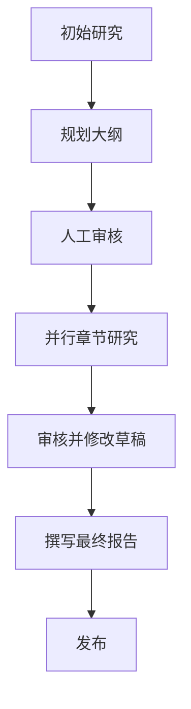
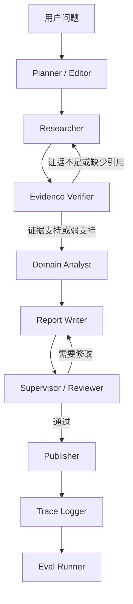

# GPT Researcher 魔改计划

创建日期：2026-06-24

## 1. 项目定位

项目名称：

> BuildScope AgentLab

简历标题：

> 垂直领域深度研究多 Agent 系统 | Planner + Researcher + Evidence Verifier + Domain Analyst + Trace + Eval

一句话定位：

> 基于 GPT Researcher，将通用深度研究工作流魔改为面向建筑/工程规范与行业风险分析的垂直多 Agent 研究系统，并加入证据校验、领域分析、运行链路 Trace 和 Eval 评测。

## 2. 为什么做这个魔改

本地收集到的高匹配 Agent 实习 JD 反复强调：

- Agent 框架架构
- 规划与执行
- Tool Use / Function Calling / MCP
- Memory 与上下文管理
- 多 Agent 编排
- Engineering Harness
- Trace 与可观测性
- Benchmark 与 Eval
- 失败诊断
- Agentic RL 与长链路任务稳定性

因此，这个项目不应该被包装成普通 RAG demo，而应该被包装为：

> 一个基于成熟 research agent 二次开发的 Agent 工作流与评测 Harness。

## 3. 保留的基线能力

保留 GPT Researcher 原有能力：

- Web research
- 来源抓取
- 研究大纲规划
- 并行章节研究
- 草稿审核与修改
- 最终报告撰写
- Markdown/PDF/Docx 发布

保留原始多 Agent 工作流作为 baseline：



## 4. 计划中的魔改架构

目标工作流：



## 5. 需要新增的模块

## 5.1 Evidence Verifier Agent

目标：

- 检查每个关键结论是否有证据支撑。
- 区分“有引用”和“引用确实支撑该结论”。
- 减少生成报告中的无依据结论。

输入：

- 报告草稿
- 抽取出的关键 claim
- 来源 URL 或引用片段

输出 schema：

```json
{
  "claim": "...",
  "status": "supported | weakly_supported | unsupported | missing_citation",
  "evidence": "...",
  "reason": "...",
  "revision_suggestion": "..."
}
```

实现位置：

- 新文件：`multi_agents/agents/evidence_verifier.py`
- 集成点：`ResearchAgent.run_depth_research` 之后，或 `WriterAgent.run` 之前

简历价值：

- 匹配 JD 关键词：Eval、证据一致性、失败诊断、稳定性、可控性。

## 5.2 Domain Analyst Agent

目标：

- 将原始研究证据转化为建筑/工程风险分析。
- 利用你的土木/建筑背景形成差异化。

输入：

- 经过校验的研究发现
- 原始问题
- 报告章节主题

输出字段：

- 适用规范或业务上下文
- 风险等级
- 缺失信息
- 假设条件
- 需要人工确认的事项
- 修改建议

实现位置：

- 新文件：`multi_agents/agents/domain_analyst.py`
- 集成点：Evidence Verifier 之后，Writer 之前

简历价值：

- 将项目从通用 research agent 升级为垂直行业 Agent。

## 5.3 Trace Logger

目标：

- 记录完整多 Agent 执行链路。
- 帮助调试长链路 Agent 失败问题。

Trace schema：

```json
{
  "run_id": "...",
  "query": "...",
  "planner_output": {},
  "research_sections": [],
  "verifier_results": [],
  "domain_analysis": [],
  "writer_output": "",
  "reviewer_feedback": "",
  "final_report_path": "",
  "created_at": "..."
}
```

实现位置：

- 新文件：`multi_agents/utils/trace_logger.py`
- 输出目录：`outputs/<run_id>/trace.json`

简历价值：

- 匹配 JD 关键词：Trace、可观测性、Engineering Harness、失败诊断。

## 5.4 Eval Runner

目标：

- 构建一个小型评测集并衡量报告质量。
- 避免项目看起来只是 prompt demo。

初始指标：

- 引用覆盖率
- 无依据 claim 数量
- 缺失引用数量
- 报告结构完整度
- 领域分析完整度
- verifier 拦截次数

实现位置：

- 新目录：`evals/buildscope_eval/`
- 文件：
  - `cases.jsonl`
  - `run_eval.py`
  - `eval_report.md`

简历价值：

- 匹配 JD 关键词：Benchmark、Eval、bad case analysis、数据驱动迭代。

## 6. 一周开发计划

## Day 1：跑通基线并阅读架构

状态：

- [x] 下载项目。
- [x] 创建虚拟环境。
- [x] 安装依赖。
- [x] 验证 import。
- [x] 验证 Web demo server 可以启动。
- [ ] 填写 `.env` key。
- [ ] 跑通一个普通 research query。
- [x] 阅读 README 和核心目录。
- [x] 创建 `docs/source_architecture.md`。
- [x] 创建 `docs/remix_plan.md`。

## Day 2：垂直场景与报告模板

任务：

- 将 `multi_agents/task.json` 改成建筑/工程风险分析 query。
- 添加项目专属 guidelines。
- 定义目标报告结构：
  - 背景
  - 研究计划
  - 关键证据
  - 风险分析
  - 缺失信息
  - 建议
  - 引用
  - 局限性
- 生成两份 baseline 报告。

## Day 3：Evidence Verifier

任务：

- 实现 `EvidenceVerifierAgent`。
- 定义 claim verification schema。
- 在 baseline report 上运行。
- 保存 verifier 输出。
- 收集至少两个 unsupported claim 案例。

## Day 4：Domain Analyst

任务：

- 实现 `DomainAnalystAgent`。
- 增加建筑/工程风险分析输出。
- 对比加入 Domain Analyst 前后的报告变化。

## Day 5：Trace 与 Eval

任务：

- 实现 `TraceLogger`。
- 保存 run-level JSON trace。
- 创建 10 条 eval cases。
- 跑第一次 eval，并撰写 `eval_report.md`。

## Day 6：README 与 Demo

任务：

- 重写魔改项目 README。
- 添加架构图。
- 添加 Agent 职责表。
- 添加 demo queries。
- 添加报告样例。
- 添加 trace 样例。
- 添加 eval 指标。

## Day 7：简历与面试防守

任务：

- 撰写简历项目经历。
- 写 1 分钟项目介绍。
- 写 3 分钟项目介绍。
- 准备 10 个高频面试问题。

## 7. 第一个 Demo Query 候选

`.env` 配好后，可以先使用以下问题之一：

1. `What are the latest trends and engineering challenges of AI agent frameworks in 2026?`
2. `How do multi-agent systems improve deep research report generation compared with ordinary RAG?`
3. `What are the key technical requirements for building reliable AI Agent products?`

后续垂直场景 query：

1. `面向建筑规范审查场景，AI Agent 系统需要解决哪些检索、证据校验和风险解释问题？`
2. `建筑工程风险分析中，如何设计一个多 Agent 系统来完成资料检索、证据校验和报告生成？`

## 8. 简历撰写方向

初始英文简历 bullet：

> Based on GPT Researcher, redesigned a general deep research workflow into a vertical multi-agent system for architecture/engineering regulation and risk analysis. Added an evidence verification agent, domain analysis agent, trace logging, and eval cases to improve citation reliability, report controllability, and long-horizon task diagnosability.

中文简历 bullet：

> 基于 GPT Researcher 二次开发垂直行业深度研究多 Agent 系统，将通用 research workflow 改造为 Planner-Researcher-Evidence Verifier-Domain Analyst-Writer 的协作流程；新增证据校验、领域风险分析、运行链路 Trace 与 Eval 测试集，用于提升报告引用可靠性、长链路任务可观测性和复杂问题分析能力。

## 9. 成功标准

本周结束前：

- [ ] baseline GPT Researcher query 可以在本地跑通
- [ ] 至少生成一份垂直研究报告
- [ ] Evidence Verifier 存在，并能输出结构化结果
- [ ] Domain Analyst 存在，并能输出风险分析
- [ ] 至少 3 次运行保存 `trace.json`
- [ ] 存在 10 条 eval cases
- [ ] README 能清楚解释魔改内容
- [ ] 简历项目经历准备完成
