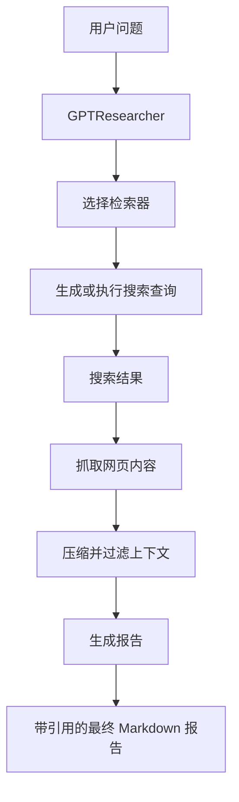
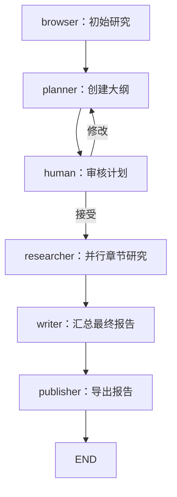
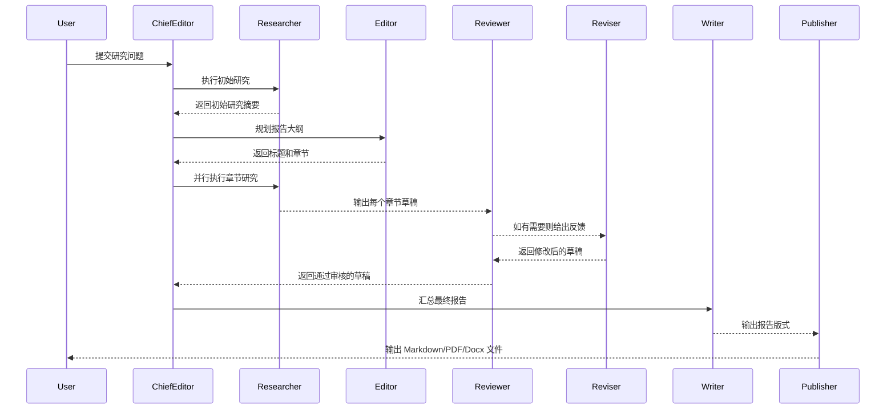

# GPT Researcher 原始架构笔记

创建日期：2026-06-24

## 1. 今日目标

这份笔记的目标，是在魔改 GPT Researcher 之前，先理解原项目的架构与关键模块，为后续将它改造成面向 Agent 实习投递的垂直多 Agent 项目打基础。

目标项目方向：

> BuildScope AgentLab：一个面向垂直领域深度研究的多 Agent 系统，包含证据校验、领域分析、运行链路 Trace 和 Eval 评测。

## 2. 仓库入口

关键文件与目录：

| 路径 | 作用 |
| --- | --- |
| `README.md` | 官方安装说明、架构概览和 demo 指南。 |
| `main.py` | FastAPI Web demo 入口。 |
| `cli.py` | 命令行入口。 |
| `gpt_researcher/agent.py` | 核心 `GPTResearcher` 类，负责编排研究、网页抓取、上下文压缩和报告生成。 |
| `gpt_researcher/actions/` | 底层动作模块，包括检索器选择、查询规划、网页抓取、报告生成辅助函数等。 |
| `gpt_researcher/skills/` | 主 Agent 使用的高层能力，例如研究执行、上下文管理、写作、浏览、来源筛选和深度研究。 |
| `gpt_researcher/retrievers/` | 搜索后端，例如 Tavily、DuckDuckGo、Bing、Google、Arxiv、MCP 等。 |
| `backend/` | Web 后端和 WebSocket 执行路径。 |
| `frontend/` | 前端 demo。 |
| `multi_agents/` | 基于 LangGraph 的多 Agent 研究工作流，这是后续魔改最相关的目录。 |
| `evals/` | 已有评测示例，后续增加项目专属 Eval 时可作为参考。 |

## 3. 单 Agent GPTResearcher 流程

核心类是 `gpt_researcher/agent.py` 中的 `GPTResearcher`。

`GPTResearcher.__init__` 中初始化的重要字段：

- `query`：原始研究问题。
- `report_type`：报告模式，例如 research report、subtopic report 或 deep research。
- `report_source`：信息来源类型，通常是 web 或 local。
- `retrievers`：从配置中选择的搜索后端，默认是 Tavily。
- `memory`：基于 embedding 的记忆模块，用于上下文压缩。
- `research_conductor`：负责执行研究流程。
- `report_generator`：负责撰写最终报告。
- `context_manager`：负责压缩和过滤抓取到的上下文。
- `scraper_manager`：负责浏览和抓取 URL。
- `source_curator`：负责筛选和管理信息来源质量。
- `deep_researcher`：可选的递归深度研究能力。

典型 pip 包调用流程：

```python
researcher = GPTResearcher(query="What are AI agents?")
research_result = await researcher.conduct_research()
report = await researcher.write_report()
```

概念流程：



## 4. 搜索与检索

检索器选择逻辑位于：

- `gpt_researcher/actions/retriever.py`
- `gpt_researcher/config/config.py`

默认检索器：

- `tavily`

支持的检索器包括：

- Tavily
- DuckDuckGo
- Bing
- Google
- Arxiv
- Serper
- SearchAPI
- Semantic Scholar
- PubMed Central
- MCP
- Custom retriever

这对魔改项目的意义：

- 计划中的项目可以保留 GPT Researcher 的 Web 检索能力。
- 后续可以增加垂直来源模式，例如建筑规范、工程资料或 JD markdown 文件。
- MCP 对未来工具集成有价值，但第一天不必强行加入。

## 5. 多 Agent 架构

`multi_agents/` 目录包含一个基于 LangGraph 的多 Agent 工作流。

`multi_agents/README.md` 中描述的多 Agent 团队包括：

| Agent | 职责 |
| --- | --- |
| Human | 可选的人类审核者，用于 human-in-the-loop。 |
| Chief Editor | 使用 LangGraph 编排整个工作流。 |
| Researcher | 调用核心 GPTResearcher 执行研究。 |
| Editor | 规划报告章节，并管理并行子主题研究。 |
| Reviewer | 检查每个草稿并提供反馈。 |
| Reviser | 根据 Reviewer 的反馈修改草稿。 |
| Writer | 汇总最终报告的引言、结论、目录和来源。 |
| Publisher | 将最终报告导出为 Markdown、PDF 和 Docx。 |

编排逻辑位于：

- `multi_agents/agents/orchestrator.py`

核心图结构：



## 6. 多 Agent 文件级阅读

### 6.1 ChiefEditorAgent

文件：

- `multi_agents/agents/orchestrator.py`

关键职责：

- 创建输出目录。
- 初始化各个 Agent。
- 构建 LangGraph `StateGraph`。
- 定义流程：`browser -> planner -> human -> researcher -> writer -> publisher`。

重要节点：

```python
workflow.add_node("browser", agents["research"].run_initial_research)
workflow.add_node("planner", agents["editor"].plan_research)
workflow.add_node("researcher", agents["editor"].run_parallel_research)
workflow.add_node("writer", agents["writer"].run)
workflow.add_node("publisher", agents["publisher"].run)
workflow.add_node("human", agents["human"].review_plan)
```

### 6.2 EditorAgent

文件：

- `multi_agents/agents/editor.py`

关键职责：

- 读取初始研究结果。
- 创建报告大纲。
- 针对每个规划章节运行并行研究。
- 创建内部子图：`researcher -> reviewer -> reviser`。

这是很自然的改造入口，可用于加入：

- 领域特定规划规则
- 报告章节模板
- 查询约束
- 证据要求

### 6.3 ResearchAgent

文件：

- `multi_agents/agents/researcher.py`

关键职责：

- 封装核心 `GPTResearcher`。
- 针对原始问题运行初始研究。
- 针对每个章节运行深度研究。

重要调用：

```python
researcher = GPTResearcher(...)
await researcher.conduct_research()
report = await researcher.write_report()
```

这是很自然的改造入口，可用于加入：

- 垂直领域检索器设置
- 自定义来源控制
- 每个子主题的 Trace 日志
- 访问过的 URL 与来源质量追踪

### 6.4 WriterAgent

文件：

- `multi_agents/agents/writer.py`

关键职责：

- 读取所有章节级研究草稿。
- 撰写最终引言、结论、目录和来源。
- 可选地根据 guidelines 修改标题。

这是很自然的改造入口，可用于加入：

- 结构化报告 schema
- 强制章节，例如证据表、风险分析、局限性和行动建议
- 引用要求

### 6.5 PublisherAgent

文件：

- `multi_agents/agents/publisher.py`

关键职责：

- 将章节草稿组合为最终版式。
- 写出 Markdown、PDF 和 Docx 输出。

这是很自然的改造入口，可用于加入：

- 保存 Trace 摘要
- 保存 verifier 结果
- 在报告旁边保存 Eval 元数据

## 7. 原始系统流程

原始多 Agent 系统遵循以下路径：



## 8. 面向实习投递的魔改缺口

原项目很强，但如果想在简历中体现差异化，还需要做出可见改造：

1. 它仍然是通用研究系统，不是垂直行业 Agent。
2. 它有 Reviewer/Reviser，但没有显式的证据校验 schema。
3. 默认没有暴露适合简历展示的 Trace 日志。
4. Eval 虽然存在于仓库其他位置，但尚未和垂直报告工作流绑定。
5. 缺少一个能利用你建筑/土木背景的 Domain Analyst 角色。

这些缺口就是后续魔改计划的来源。

## 9. Day 1 收获

面试中可以这样说：

- GPT Researcher 原始架构采用 planner 与 execution agent 的思路：planner 生成研究问题，execution agent 收集信息，publisher 将结果聚合为报告。
- 多 Agent 版本使用 LangGraph 协调 Researcher、Editor、Reviewer、Reviser、Writer、Publisher 等角色。
- 最适合改造的位置是 `EditorAgent` 的规划逻辑、`ResearchAgent` 的研究执行逻辑、`WriterAgent` 的报告 schema，以及 `PublisherAgent` 的输出保存逻辑。
- 计划中的魔改会新增 `Evidence Verifier`、`Domain Analyst`、`Trace Logger` 和 `Eval Runner`，让项目更贴近 JD 中的 Agent framework / Engineering Harness 要求。
